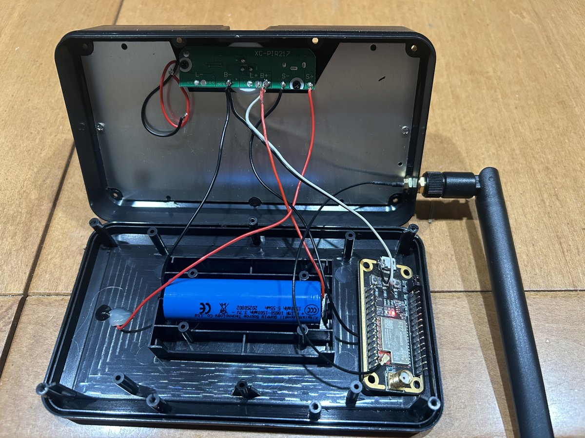
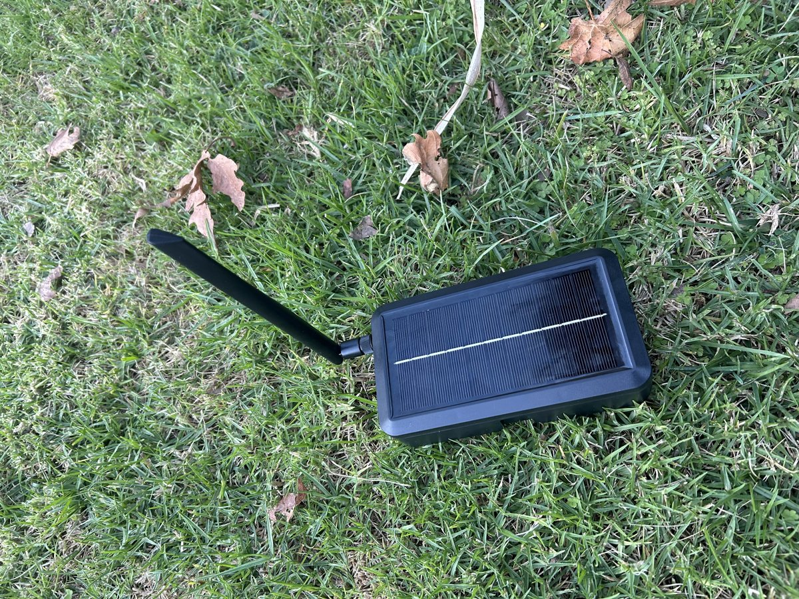

# LoRa APRS Digipeater (STM32WLE5)

A small LoRa APRS digipeater for the **Ebyte E77-400MBL-01** (STM32WLE5CC, 433 MHz). It repeats standard LoRa APRS
packets (`3C FF 01` + text), with a fill-in or wide path rule, an optional **moving stations only** mode, and you set it
up over a serial port or, for most settings, by an APRS message over the air: callsign, SSID, mode, radio settings and
the rest are typed in and saved in the chip itself. No reflashing to change a setting.

**Download:** prebuilt firmware (`.bin` and `.hex`) is on the [Releases page](https://github.com/radiohound/lora-aprs-digi/releases/latest). Flash it with an ST-LINK, no build needed.

> **Status:** tested on a PC and on an E77 on the air (see [What has been tested](#what-has-been-tested)). MIT licence.

- [What it does](#what-it-does)
- [Hardware](#hardware)
- [Build and flash](#build-and-flash)
- [First start](#first-start)
- [Changing settings](#changing-settings)
- [All the settings](#all-the-settings)
- [Reading the log](#reading-the-log)
- [What has been tested](#what-has-been-tested)
- [Size](#size)
- [Source files and tests](#source-files-and-tests)
- [Credits](#credits)

---

## What it does

It listens all the time (the processor sleeps between interrupts) and repeats what it hears: a standard LoRa APRS
frame (`3C FF 01` + TNC2 text) is sent again as the same text with the new path. Any other kind of frame is ignored.

**Path rule** (the same as the LoRa APRS Pi): the first hop not yet used decides.

| Mode | Repeats |
|---|---|
| `off` | nothing (it still beacons and answers settings messages) |
| `fillin` | `WIDE1-1` and packets addressed to its own callsign (`MYCALL`) → `MYCALL*` |
| `wide` (default) | also `WIDE2-1` → `MYCALL*`, and `WIDE2-2` → `MYCALL*,WIDE2-1` |

It never repeats a path that breaks the WIDEn-N rule, its own packets, a packet it already repeated, or the same
packet twice within 30 seconds (`dedupe`).

**Polite on the channel**
- **Listen before talk** (as the LoRa APRS Pi): before each transmission the channel must be found free twice in a
  row (one check is a channel-activity detection of about 4 symbols, 131 ms at SF12). A busy channel backs off 1 to 4
  slots while still receiving; after 10 s the repeat is given up. A packet arriving counts as busy.
- **Random delay** of 100 to 500 ms first, so two digipeaters rarely key at once.
- **Cancel on hear** (as the Pi): a repeat still waiting is dropped when another digipeater is heard repeating the
  same packet first (same source, destination and content, more hops used).

**Station list.** Every packet it can read updates a table of 48 stations: where each
last reported itself, when, and for stations heard on the air the signal and SNR. `stats` prints it. It is never
transmitted.

**Moving stations only** (`set moving on`, off by default). Repeats a station's first position, and any position at
least `move_m` (100 m) from the last one it repeated for that station; always repeats a path that names this digi and
tocalls listed in `always_tocalls`; skips a fixed station heard again in the same place. Positions are read from
uncompressed, compressed and Mic-E packets.

**Beacon.** Optional fixed position as plain text. **Off until you set both `lat` and `lon`** (both 0 = no beacon),
so by default the digipeater never sends its own position.

**Safety.** Until a real callsign is set (it starts as `N0CALL`) it relays and beacons nothing. A watchdog restarts
it if the main loop ever stops for 20 seconds.

---

## Hardware

| | |
|---|---|
| Module | Ebyte **E77-400MBL-01** (STM32WLE5CC, 256 KB flash, 64 KB RAM). Modules with serial number 3202995 or higher have a TCXO (1.7 V in this firmware). |
| RF switch | PA6, PA7, PB3 (verified on PicoTrack) |
| Serial port | **LPUART1: PA2 = TX, PA3 = RX**, 3.3 V logic, 115200 baud, 8N1 |
| Programmer | ST-LINK V2 on SWD (SWDIO, SWCLK, GND, and NRST helps). SWD stays attachable while the firmware sleeps (`D3_DEBUG_SWD`, see Build and flash) |
| LEDs (MBL baseboard) | **LED1 (PB4) = receive**: flashes for every packet heard, long for a good packet, short for a CRC error. **LED2 (PB3) = transmit**: PB3 is the RF-switch line that is high only while transmitting, so LED2 lights for every transmission with no code (this is also why it cannot be switched off with `leds`). Both LEDs have 5.1 kΩ resistors to ground, and each needs its **jumper** from the PB4 / PB3 header pin to the LED1 / LED2 pin. Set `leds off` to save a little current at a battery site (it turns off only LED1). |
| Keys (MBL baseboard) | **用户按键1 (Key 1, the middle button) = PA1, 用户按键2 (Key 2, the bottom one) = PA0**, active low (PA1 confirmed on a board; the manual does not give the pins). Read at power-up or reset. **Hold PA0**: the compiled-in defaults come back and are saved (rescue for bad radio settings or a forgotten secret; the over-the-air counter is kept, as with `defaults`, so recorded messages still cannot be replayed). **Hold PA1**: jump to the chip's built-in serial bootloader, which listens on USART2 (PA2/PA3, the same pins as the board's USB-serial) and on USART1 (PA9/PA10). Tested on a board: the chip enters it and the bootloader answers on the USB-serial. Costs about 0.5 KB of flash; `KEYS_ENABLED 0` removes it. |
| Power | 3.3 V. Not yet measured with this firmware: it receives all the time. |

You need a **3.3 V USB-serial adapter** on PA2/PA3 (and GND) to talk to it. An ST-LINK V2 has no serial port of its
own, so it cannot do this job; it is only for programming. Cross the lines: adapter RX to PA2, adapter TX to PA3.

### Fits in a solar garden light

The E77 module on its MBL baseboard fits inside an ordinary solar garden light, which makes a cheap, self-contained,
solar-powered digipeater. The light's own panel, charge board and 18650 cell power the module, and a short pigtail
runs to an SMA bulkhead on the case for an external antenna.

| Inside | Closed up |
|---|---|
|  |  |

---

## Build and flash

**Prebuilt:** download `lora-aprs-digi-e77.bin` (flash at `0x08000000`) or the `.hex` from the [latest release](https://github.com/radiohound/lora-aprs-digi/releases/latest), check it against `SHA256SUMS.txt`, and program it with an ST-LINK (for example STM32CubeProgrammer). To build it yourself:

Needs [PlatformIO](https://platformio.org/) (VS Code extension, or `pio` on the command line).

```
git clone <this repository>
cd <this repository>
pio run -e e77_digi                 # build
pio run -e e77_digi -t upload       # flash with the ST-LINK
```

Or with openocd (flashing the build output directly):

```
openocd -f interface/stlink.cfg -f target/stm32wlx.cfg \
        -c "program .pio/build/e77_digi/firmware.elf verify reset exit"
```

The program leaves the **last 2 KB flash page free**: that is where your settings are saved (`platformio.ini` lowers
the linker's flash size by one page, `board_upload.maximum_size = 260096`, so the program cannot grow into it).
Flashing a new version keeps your saved settings. `defaults` followed by `save` puts the compiled-in values back.

**Debug port stays awake.** The processor sleeps between interrupts, which normally switches the SWD debug clock off,
so the ST-LINK could only attach in the moment after a reset. This build keeps SWD alive in sleep and in the battery
sleep (`D3_DEBUG_SWD`, default 1), so you can attach and flash at any time. It costs a little sleep current; a
battery site can build with `-D D3_DEBUG_SWD=0` (then hold reset, release it, and start the upload at once).

---

## First start

Open a terminal on the serial port, for example on a Mac:

```
screen /dev/cu.usbserial-1120 115200        # quit: Ctrl+A, then K, then Y
```

(the port name varies; `ls /dev/cu.usbserial*` shows it). On Windows use PuTTY or the PlatformIO serial monitor;
on Linux `screen /dev/ttyUSB0 115200`. Turn **local echo off**: the firmware echoes what you type. Backspace works,
and Enter may send CR or LF. The port is only open to one program at a time.

Every start prints this. A fresh chip, with nothing saved yet:

```
=== LoRa APRS digipeater (STM32WLE5) ===
[Settings] none saved yet, using the compiled-in defaults
[Boot] callsign N0CALL-10
[Boot] callsign is N0CALL: nothing is relayed or beaconed. Type  set call YOURCALL-SSID  then  save  (help lists everything)

Commands (type one and press Enter):
  show                 every setting and its value        get NAME      one setting
  set NAME VALUE       change a setting, e.g.  set call K6ATV-2   (a text value of - means empty)
  save                 keep the changes after a power-off  defaults      load the compiled-in values
  apply                use changed radio settings (freq, bw, sf, cr, power, sync, preamble, boosted)
  stats  beacon  reboot [force]  help (lists every setting and its range)
Changes work at once, except the radio settings, which need apply.

[Radio] init... OK
```

After you have saved settings, the second line says how many were loaded and the callsign is yours:

```
=== LoRa APRS digipeater (STM32WLE5) ===
[Settings] loaded <n> from flash
[Boot] callsign K6ATV-2
```

There is no prompt: it is waiting for you to type. Packet log lines (see below) may appear in the middle of what you
are typing; keep going and press Enter. `set log off` silences them.

---

## Changing settings

A session that sets the callsign, changes the mode and keeps both:

```
set call K6ATV-2
ok: callsign = K6ATV-2
(not saved yet: type save to keep it after a power-off)
set mode fillin
ok: mode = fillin
save
saved <n> bytes to flash
```

How it behaves:

- **Every value is checked when you type it.** A refused value changes nothing and says why:

  ```
  set sf 13
  error: sf: out of range
  set call BAD CALL
  error: call: wrong length
  set sf 9 oops
  error: sf: one value only
  set bw 100
  error: bw: not a LoRa bandwidth (7.8 10.4 15.6 20.8 31.25 41.7 62.5 125 250 500 kHz)
  ```
- **`set call K6ATV-2`** sets the callsign and the SSID together. `set call K6ATV` changes only the callsign.
- **Text settings** (`comment`, `path`, `always_tocalls`) take the rest of the line. `-` means empty
  (`set path -`). Callsigns, paths and tocalls are upper-cased for you.
- **Most changes work at once.** The **radio settings** (`freq`, `bw`, `sf`, `cr`, `power`, `sync`, `preamble`) need
  `apply`. If the radio refuses them, the previous ones stay in use:

  ```
  set freq 439.9125
  ok: freq = 439.9125 MHz
  (radio setting: type apply to use it)
  apply
  ok: radio settings applied
  ```
- **`save` keeps the settings across a power-off.** It writes nothing when nothing changed
  (`already saved, nothing written`), and is **refused while radio settings are typed but not applied**, so a value the
  chip rejects is never saved.
- **`reboot`** restarts. With unsaved changes it refuses and says so; `reboot force` drops them.
- **`defaults`** loads the compiled-in values into RAM (then `apply` and `save` to keep them).
- **`beacon`** queues the beacon now (needs a callsign and a position).

### What `show` prints

```
show
callsign K6ATV-2
call = K6ATV *
ssid = 2 *
mode = wide
delay_min = 100 ms
delay_max = 500 ms
cad_difs = 2 checks
cad_backoff = 4 slots
cad_wait = 10 s
cancel = on
dedupe = 30 s
moving = off
move_m = 100 m
stationary_min = 0 min
mv_messages = on
mv_other = off
always_tocalls = -
log = on
lat = 0 deg
lon = 0 deg
sym_table = L
sym_code = #
comment = LoRa APRS digi, STM32WLE5
path = -
tocall = APZLD3
beacon_min = 60 min
beacon_first = 30 s
stats_min = 10 min
freq = 433.775 MHz *
bw = 125 kHz *
sf = 12 *
cr = 4/5 *
power = 22 dBm *
sync = 0x12 *
preamble = 8 symbols *
boosted = on *
leds = on
remote = on
secret = (not set: the chip ID) *
rc_counter = 0 *
rc_path = WIDE1-1
* = serial port only, cannot be changed over the air
```

A `*` marks a setting that can only be changed on the serial port, not by an [APRS message over the air](#settings-over-the-air):
the callsign and SSID, the radio settings, and the secret and its counter. `help` marks them the same way. `get NAME` prints one
line without the mark, for example `get freq` → `freq = 433.775 MHz`.

### How the saved settings are kept

One record in the last 2 KB flash page: a list of numbered entries and a CRC32, 256 bytes. On start-up every entry is
checked against the same ranges as `set`, so a damaged or out-of-range record can never load a value the radio would
refuse (bad entries are skipped and counted: `[Settings] loaded 37 from flash, 2 refused (out of range)`). A newer
firmware reads an older record (new settings take their defaults). If a saved radio setting is refused by the chip at
start-up, the digipeater falls back to the compiled-in radio values instead of hanging. The page is erased only when the
record changes (flash is good for about 10,000 erase cycles).

### Settings over the air

A few settings can also be changed with an APRS message to the digipeater's callsign, so a digi on a hill can be
adjusted without climbing it. Each message carries a code that only someone holding the digi's key can make:

```
python3 tools/remote_code.py K6ATV-10 --chip 2F0040001350524E34393620 "set moving on"
<counter> set moving on <8-letter code>
```

Or use **`tools/remote_code.html`** on a phone: one file, works offline, makes the same codes, and has a Copy button
and the common commands as buttons. Save your own copy of the file on the phone (or serve it from your own GitHub
Pages): whoever can change the page you use could change it to leak your key. It can remember the callsign and key on
that device (off unless you tick it).

Send the printed line as an APRS message to K6ATV-10 (APRSdroid, a tracker, the LoRa APRS Pi...). The digi acks it
(if the message has a number) and answers with a message: `moving = on (not saved)`. A change works at once but is
only kept after a `save`, so a mistake is undone by a restart.

* **What can be sent:** `get`, `set`, `save`, `beacon`, `reboot`. **Not** over the air: the callsign and SSID, the radio
  settings (`freq`, `bw`, `sf`, `cr`, `power`, `sync`, `preamble`, `boosted`: one wrong value and it could not hear you
  any more), the secret, `defaults` and `apply`.
* **Battery voltage:** `get battery` answers with the live supply voltage and its state, for example
  `battery 3.21 V, ok`. The digi never sends the voltage by itself; it is read only when asked. It also works while the
  battery is low, because answers to commands still go out then.
* **The key** is the chip's 96-bit unique ID, printed at start-up (`[Boot] settings over the air on, key: chip ID ...`),
  unless you set your own on the serial port with `set secret ...` (then use `--secret` with the tool). The ID or secret
  never goes on the air; anyone can read the command, as amateur radio requires, but only the code proves who sent it.
* **The code:** SipHash-2-4 keyed with the secret, over `MYCALL|counter|command`, 40 bits as 8 letters/digits. The
  **counter** (the tool uses the time in seconds) must be higher than the last one accepted, which is kept in flash, so
  a recorded message cannot be sent again. The same message again (a retry) is answered again but not run again.
* **Wrong codes** are ignored without an answer; after 5 in a row commands are ignored for 10 minutes.
* A message to the digi is answered, never repeated. `rc_path` sets the path of the answers (default `WIDE1-1`, so a sender out of direct range still hears the answer through a digipeater; empty: direct).
* `set remote off` turns it off. Each answer costs about 2 s of airtime at SF12 (and the ack another 2 s).

---

## All the settings

Defaults are the values in `src/digi3/config_digi3.h`. **Radio** settings need `apply`. A `*` after the name means serial port only (not over the air).

| Name | Default | Range | Meaning |
|---|---|---|---|
| `call` * | `N0CALL` | 1–6 letters/digits | callsign (accepts `-SSID` when set) |
| `ssid` * | 10 | 0–99 | 0 = none (the AX.25 spec stops at 15, but higher ones such as -30 are widely used) |
| `mode` | `wide` | `off`, `fillin`, `wide` | which hops are repeated (see above); `off` repeats nothing but still beacons and answers settings messages |
| `delay_min`, `delay_max` | 100, 500 ms | 0–10000 | random wait before repeating (`delay_min` ≤ `delay_max`) |
| `cad_difs` | 2 | 1–10 | free channel checks in a row before transmitting |
| `cad_backoff` | 4 | 1–20 slots | longest random wait when the channel is busy |
| `cad_wait` | 10 s | 1–120 | give up a repeat after this long |
| `cancel` | on | on/off | cancel on hear |
| `dedupe` | 30 s | 1–3600 | same packet heard again within this time is not repeated |
| `moving` | off | on/off | moving stations only |
| `move_m` | 100 m | 1–100000 | distance that counts as moved |
| `stationary_min` | 0 | 0–10080 | also repeat a fixed station after this many minutes (0 = never) |
| `mv_messages` | on | on/off | moving-only: still repeat messages and acks |
| `mv_other` | off | on/off | moving-only: repeat other packets without a position |
| `always_tocalls` | empty | up to 39 chars | moving-only: destination prefixes always repeated, e.g. `APLAIX,APLAB` |
| `log` | on | on/off | per-packet log (command replies and `stats` always print) |
| `stats_min` | 10 | 0–1440 | counters printed every this many minutes (0 = never) |
| `lat`, `lon` | 0, 0 | ±90, ±180 deg | beacon position; **both 0 = no beacon** |
| `sym_table`, `sym_code` | `L`, `#` | 1 char each | APRS symbol (`L#` = LoRa digipeater overlay) |
| `comment` | `LoRa APRS digi, STM32WLE5` | up to 43 chars | beacon comment (no `|` or `~`) |
| `path` | empty | up to 23 chars | beacon path, e.g. `WIDE1-1` |
| `tocall` | `APZLD3` | 1–6 chars | beacon destination (experimental APZ) |
| `beacon_min` | 60 | 1–1440 | beacon interval |
| `beacon_first` | 30 s | 0–3600 | first beacon after power-up |
| `freq` * | 433.775 MHz | 410–510 (radio) | up to 6 decimals |
| `bw` * | 125 kHz | LoRa bandwidths (radio) | 7.8, 10.4, 15.6, 20.8, 31.25, 41.7, 62.5, 125, 250, 500 |
| `sf` * | 12 | 5–12 (radio) | spreading factor |
| `cr` * | 4/5 | 4/5–4/8 (radio) | coding rate; `5`–`8` also accepted |
| `power` * | 22 dBm | 0–22 (radio) | transmit power |
| `sync` * | `0x12` | 0–255 (radio) | sync word, decimal or `0x..` |
| `preamble` * | 8 | 6–255 (radio) | preamble symbols |
| `boosted` * | on | on/off (radio) | boosted receive gain (about 2–3 dB more sensitivity for about 0.7 mA) |
| `leds` | on | on/off | the RX LED (LED1); see [Hardware](#hardware). LED2 shows transmissions through the RF switch line and cannot be switched off. |
| `remote` | on | on/off | settings over the air |
| `secret` * | empty | up to 32 chars | the key for settings over the air; empty = the chip ID (never shown, serial port only) |
| `rc_counter` * | 0 | | the last counter accepted over the air (kept so a recorded message cannot be replayed) |
| `rc_path` | `WIDE1-1` | up to 23 chars | path of the answers to commands over the air |

Fixed at build time (they depend on the board or the program): TCXO voltage, RF switch pins, current limit, queue and
table sizes, watchdog time, serial speed. `help` on the device lists every setting with its range.

---

## Reading the log

With `log on`, every packet heard is printed with its length, RSSI, SNR and frequency error, then what was done:

```
[RX] 52 B -40 dBm 7.0 dB -133 Hz: repeat K6ATV-3>APZLPI,K6ATV-2*:!3700.00NL12130.00W&
[TX] 52 B sent
```

The other outcomes are named: `duplicate`, `already repeated by this station`, `not a hop this digipeater serves`,
`cancelled, already repeated by another digi`, `queue full`, and so on. (Example lines are illustrative.)

`stats` (and every `stats_min` minutes) prints the counters and the station list:

```
stats
[Stats] heard 6, CRC errors 0, repeated 2, duplicates 0, not LoRa APRS text 0, damaged 0, busy drops 0, queue full 0, beacons 0, channel busy 13, cancelled 0, fixed stations skipped 0, other skipped 0
  K6ATV-3  heard 0 min ago -41 dBm 5.0 dB direct  at <lat>,<lon> 0 min ago
  K6ATV-4  heard 2 min ago -46 dBm 4.8 dB direct  at <lat>,<lon> 2 min ago
  K6ATV-10  heard 0 min ago -105 dBm -16.0 dB
```

(Positions replaced by `<lat>,<lon>` here.) A station with no `at` was heard but has not sent a position this digipeater
can read.

---

## What has been tested

**On a PC** (`test/host`): 52 checks on the digipeater core (the path rule, duplicate keys, positions against aprslib, the
moving rules, the station list), 452 on the settings (every command, every range, a `show` → `set` round trip for every
setting, the flash record, and every single-bit error and truncation of a record caught), 40 on settings over the air (with
python3, also that `tools/remote_code.py` gives the same codes), 32 on the battery states, and 7 on
`tools/remote_code.html`:

```
make -C test/host test
make -C test/host test-settings
make -C test/host test-remote      # settings over the air
make -C test/host test-battery
node test/host/test_remote_html.js # tools/remote_code.html against the reference vector and remote_code.py
```

**On a real E77, 8 November 2026** (an earlier build of this firmware; the settings, serial commands,
remote control, listen-before-talk and moving-stations code were the same): start-up with blank flash and with a saved
record, refused values, `apply`, `save`, `reboot`, `defaults`, `stats`; repeating on the air, heard by a LoRa APRS Pi;
moving-stations-only (first position repeated, second packet from the same place skipped); two read-only commands over
the air from a T-Deck.

**This plain build on a real E77, 11 November 2026:** flashed over the ST-LINK, settings restored on the serial port and saved.
On the air, a T-Deck tracker (`K6ATV-4`, SF12, path `WIDE1-1`, compressed position) was heard at -55 dBm and its first position
was repeated (`new station`); its two later packets from the same place were skipped (`fixed station, not moved`), and a
packet another station had already repeated was left alone (`no hops left`). `get battery` was sent over the air from a
T-Deck and the digi answered with its supply voltage.

Not yet tested: the `D3_DEBUG_SWD` setting (attaching the ST-LINK while the firmware sleeps), over-the-air `set` and `save`, a station that has moved 100 m or more in moving mode, cancel on
hear, a true power-off, a radio setting the chip itself refuses, power consumption, battery watching on a real battery, a long run.

---

## Size

Built with RadioLib 7.x, the Arduino STM32 core, arm-none-eabi-gcc, `-Os`:

| | Used | Of |
|---|---|---|
| Flash | **87,968 bytes** | 260,096 usable (the last 2 KB page is reserved for the settings) |
| RAM, fixed | about 8 KB | 64 KB |

---

## Source files and tests

```
platformio.ini              environment e77_digi (-D D3_WITH_MODEL -D HB_FAST)
src/digi3/main_digi3.cpp    the firmware: radio, receive, transmit queue, listen before talk, serial commands, flash
src/digi3/digi3_core.c      the decision and the frame to send (plain C, tested on a PC)
src/digi3/neighbors.c       station list, position reading, moving-stations rules
src/digi3/settings.c        the settings table, the command parser, the flash record
src/digi3/remote.c          settings over the air: SipHash codes, APRS message parsing (plain C, tested on a PC)
tools/remote_code.py        makes the message text for a command over the air (Python 3, no packages)
tools/remote_code.html      the same as a web page for a phone (one file, offline)
src/digi3/config_digi3.h    the DEFAULTS (everything else can be changed over the serial port)
test/host/                  PC tests
```

To add a setting: append a line to the table in `settings.c` (never reorder: a setting's number in the flash record is
its position), add its field to `d3_settings_t` and its default in `d3s_defaults`.

---

## Credits

- **Walter Dunckel, K6ATV.**
- [RadioLib](https://github.com/jgromes/RadioLib) by jgromes. RF switch pins and TCXO set-up verified against
  [PicoTrack](https://github.com/radiohound/PicoTrack).
- The listen-before-talk and cancel-on-hear rules follow the LoRa APRS Pi software.

Licensed under the [MIT License](LICENSE).
